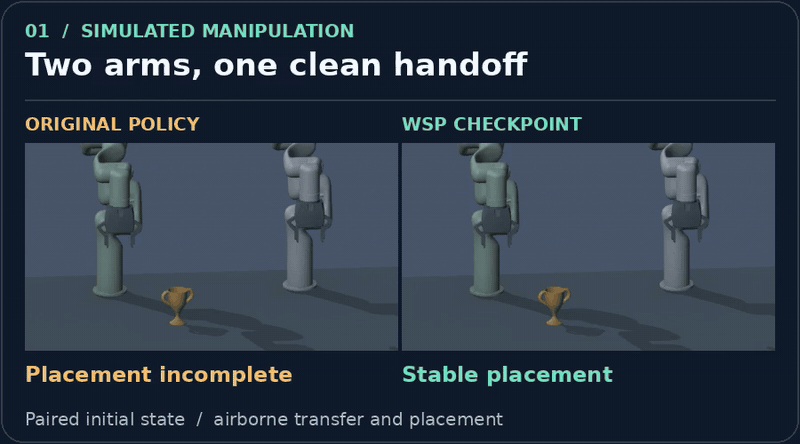

# PolicySculpt (PS) — Direct Weight Editing for Trained Policies

> Tsinghua University, College of AI · Interactive Embodied Intelligence Lab (IEI Lab) · [Lab website](https://maureenzou.github.io/lab.html)

[](#quick-start) [](#why-choose-ps) [](#paired-evaluation-results)

PolicySculpt is a Codex skill that uses Weight-Space Programming (WSP) to improve specific behaviors in trained policies. Given a checkpoint, a native inference entry point, and examples of failures, Codex traces the computations involved, edits the learned weights directly, and saves and reloads the candidate for paired evaluation against the original policy. The four cases cover robot control, game decisions, and photo retouching. All four edits used **zero gradient training steps**.

## Case Studies

### Bimanual Goblet Handoff

Two simulated arms pass a goblet in midair and set it down. PS edits **6 scalar parameters**, shifting the receiving arm's approach by **1.35 mm** and shortening the learned durations of five phases.



The original policy on the left fails the release check and leaves the goblet tilted **12.0°**. PS on the right sets the goblet down upright and stable. [Watch MP4](assets/showcase/goblet-handoff.mp4)

### Bimanual 2×2 Cube Solving

One simulated arm holds the cube while the other turns its layers according to the solver's move sequence. PS shifts the holding gripper's learned trajectory anchors **1.2 mm** toward the fixed layer to clear the rotating layer. The evaluation uses the original solver, acceptance criteria, and policies for the other moves.


The montage shows **all 11 repaired moves**, five from the original scrambles and six from the held-out scrambles. Each pair magnifies the gripper and cube around the failure, aligns the two runs by control tick, and plays the excerpt at **one-fifth speed**. Red rings mark recorded wrong-layer contacts. The green marker shows the measured clearance between the same pad and cubie after the edit. In the preview from case 06, the holding gripper touches the rotating layer during **41 of 200 control ticks**, compared with **0/200** after the edit. On hardware, such contact could obstruct the turn or jam the cube. [Watch all 11 close-ups](assets/showcase/cube-contact-closeups.mp4)

### Connect Four

Reflecting a Connect Four board preserves the rules and the win, draw, or loss value of each corresponding move. Column 1 on the original board, for example, maps to column 7 on the reflected board. The policy's encoder processes both orientations, so reflection swaps the two groups of features. The original action head learns separate weights for those groups and can assign different scores to corresponding moves, leading to inconsistent choices.


On the left, the original policy chooses column 1, a forced win according to the exact solver. On the reflected board, the winning move maps to column 7. The original policy chooses column 6, which loses against optimal play. The evaluation tracks both mirror consistency and move optimality.

PS applies an analytic projection to the final action head so that reflecting the board also reflects the action scores. It reuses the trained encoder. On the pair shown, the edited policy chooses columns 1 and 7, both winning moves.

### Exposure Photo Retouching

Exposure selects a sequence of editing operations for a photograph. The original policy sometimes clips textured highlights to white. PS edits **128 weights and one bias** in the exposure regressor. Each example shows the input, the original output, and the PS output above a close-up of the same region.


The PS output retains more detail in the illuminated structure at the base of the rocket. Photo by SpaceX, released into the public domain. [Photo source](https://scikit-image.org/docs/0.25.x/api/skimage.data.html#skimage.data.rocket)


The texture in the bright rock face beside the falls is clearer in the PS output. Photo by Gentry George, U.S. Fish and Wildlife Service, released into the public domain. [Photo source](https://commons.wikimedia.org/wiki/File:Yosemite_falls.jpg)

## Paired Evaluation Results

Each result uses its corresponding original policy as the baseline. The original 30 cube scrambles serve as a regression set. A separately frozen set of 10 scrambles tests the edit on new initial states.

| Case | Evaluation set | Metric | Original | PS |
| --- | --- | --- | ---: | ---: |
| Bimanual goblet handoff | 28 paired new simulation starts | Complete handoff and stable placement ↑ | 18/28 | **25/28** |
| Bimanual goblet handoff | The 22 starts for the `1→0` direction | Complete handoff and stable placement ↑ | 14/22 | **21/22** |
| Bimanual cube solving | 30 original scrambles | Complete solves ↑ | 21/30 | **25/30** |
| Bimanual cube solving | 5 new ordinary scrambles | Complete solves ↑ | 4/5 | **5/5** |
| Bimanual cube solving | 5 new scrambles with a high-risk move sequence | Complete solves ↑ | 0/5 | **5/5** |
| Connect Four | 24,000 held-out endgames and their reflections | Mirror disagreements ↓ | 7,928 | **0** |
| Connect Four | The same endgames, counting both orientations | Optimal move rate ↑ | 84.99% | **85.73%** |
| Connect Four | Endgames where the original policy disagreed with its reflection | Optimal move rate ↑ | 79.03% | **81.29%** |
| Exposure photo retouching | 65 eligible held-out photos | Mean clipping of recoverable highlights ↓ | 12.90% | **2.50%** |

- The goblet confirmation set intentionally includes more handoffs in the `1→0` direction. The cube replay preserved all 21 original successes.
- An exact solver determines optimal moves in Connect Four. On the endgames where the original policy disagreed with its reflection, the tuned action-bias control achieved **79.75%**.
- Of 72 held-out full-frame FiveK photos, 65 qualified for the highlight metric. A highlight counts as clipped if any color channel clips. The 95% paired bootstrap interval for the change was **−13.40 to −7.65 percentage points**. Exposure adjustments can also affect shadow rendering. [Highlight clipping chart](assets/showcase/exposure.png)

### Policy Size and Edit Size

| Case | Original policy parameters | Parameters changed by PS | Share changed |
| --- | ---: | ---: | ---: |
| Bimanual goblet handoff | 90,281 | **6** | 0.0066% |
| Bimanual cube solving | 2,084,480 | **5,474** | 0.2626% |
| Connect Four | 134,735 | **1,798** | 1.3345% |
| Exposure photo retouching | 6,123,680 | **129** | 0.0021% |

In all four cases, PS changed less than **1.34%** of the original policy's parameters and improved the target metric in paired evaluation. For the goblet handoff, editing six parameters that control the receiving arm's approach and phase timing raised the rate of complete handoffs and stable placements by **25 percentage points** on the new starts.

In these tasks, the agent traced the policy computation to identify parameters related to the target behavior and predicted how editing them would affect actions. The observed changes in paired evaluation provide experimental evidence for the role of those parameters in the tasks tested. All four repairs used direct edits and **zero gradient training steps**.

## Why Choose PS?

### When Is PS a Good Fit?

Gradient training and fine-tuning update weights using objectives derived from examples or rewards. WSP starts with a target behavior and the computations in an existing network, constructs a direct weight edit, and tests it through task evaluation. PS organizes this approach into diagnosis, editing, and validation. Training can build a policy's capabilities, and PS can then address a specific problem in that policy. [Original Weight-Space Programming article](https://rikiyat.github.io/blog/weight-space-programming/)

| Task condition | Try PS first | Prioritize training or fine-tuning |
| --- | --- | --- |
| Existing capabilities | The policy can already perform the task and needs a specific failure fixed or a behavior adjusted | The policy needs to learn new skills or representations from demonstrations, labels, or rewards |
| Failure mechanism | The behavior maps to a testable relationship such as mirror symmetry, a trajectory offset, or exposure strength | The desired improvement spans many input patterns and calls for learning a complex mapping from data |
| Available feedback | Representative failures, successes, and an existing evaluator can test candidate edits | Training signals cover the target distribution and a training pipeline is available |
| Scope of change | The goal is specific enough to predict which inputs, phases, or actions should change | The goal spans several capabilities or a substantial distribution shift |

When the effect of a parameter is predictable, PS can encode a constraint or correction directly in the relevant weights. Screening a small set of candidates can reduce the need to collect training data and run gradient optimization for that repair. The edit scope, expected behavior, and actual parameter diff can each be reviewed.

The total cost includes diagnosis, candidate screening, and task evaluation. Checking the target improvement alongside the original policy's successes helps determine whether to continue editing or move to training and fine-tuning.

### What the Skill Provides

- **Trace failures to relevant weights.** Follow the original policy's computations, formulate a testable hypothesis, and choose the edit location and magnitude. Connect Four encodes reflection symmetry in the action head, and the cube repair edits the trajectory anchors for the affected moves.
- **Produce a checkpoint that can be reloaded.** Save the candidate in a format the model can load, verify it through native inference, and report the actual parameter diff. Sparse edits can also be saved as portable checkpoint patches.
- **Use the same workflow across policy types.** The policy adapter handles checkpoint loading, inputs, outputs, and state. The task evaluator handles initial conditions, execution, and acceptance criteria. Static tasks can use fixed inputs, and robotics tasks can use an existing simulator to test closed-loop behavior.
- **Screen on a small set and confirm on held-out cases.** Screen candidates on representative failures and successes. Freeze a candidate before comparing it with the original policy on held-out cases. Long evaluations can resume sample by sample after checking that the models, inputs, and evaluation setup match.

## Quick Start

### Install

From the root of the project where you want to use the skill, run the following command. Access to the GitHub repository is required. [Codex skill setup](https://developers.openai.com/codex/skills)

```bash
git clone https://github.com/Pan-Chera/robot-weight-programming.git \
  .agents/skills/robot-weight-programming
```

### Repair a Policy Behavior

Open the project in Codex and provide the original checkpoint, native inference command, and representative inputs. Specify one behavior to fix, the behavior you want to preserve, and a screening budget. Closed-loop tasks also need the existing evaluator, initial states or a reset procedure, and acceptance criteria.

```text
Use $robot-weight-programming on this frozen checkpoint.
The native inference command and labeled examples are in this workspace.
Improve the target behavior shown in the examples and preserve the original
successes. Diagnose the relevant computation and screen direct weight edits
on the development cases. Freeze one candidate and compare it against the
original checkpoint on the held-out cases.
```

A completed run can produce an edited checkpoint, a parameter diff, and a paired report identifying the original policy, evaluation metrics, and behavior retained.

## Documentation

- Reproduce the original policy, diagnose the mechanism, screen candidates, and confirm the effect. [Skill entry point](SKILL.md)
- Connect native inference and handle state, randomness, saving, and reloading. [Policy adapters](references/adapter-and-integrity.md)
- Choose a weight edit and check for retained capabilities. [Weight interventions](references/intervention-workflow.md)
- Set evaluation budgets, stopping rules, and conditions for resuming. [Evaluation and resumption](references/research-efficiency.md)
- Connect an existing simulation or hardware evaluation workflow. [Robotics workflow](references/robot-workflow.md)
- Use affine editing, checkpoint patches, and evidence checking scripts. [Utilities](scripts/)

## Authors

**Guanxing Qu** and **Xueyan Zou**. [IEI Lab](https://maureenzou.github.io/lab.html) · [Multi-Agent CAD](https://github.com/Pan-Chera/Multi-Agent-CAD)

## Citation

If you use this skill in your research, please cite the software repository. [Machine-readable citation](CITATION.cff)

```bibtex
@misc{qu2026policysculpt,
  author       = {Qu, Guanxing and Zou, Xueyan},
  title        = {{PolicySculpt (PS): Direct Weight Editing for Trained Policies}},
  year         = {2026},
  howpublished = {GitHub repository},
  url          = {https://github.com/Pan-Chera/robot-weight-programming}
}
```

### Related Work

- **Weight-Space Programming**. Rikiya Takehi, Jayden Teoh, Alex Zhang, and Omar Khattab (2026), *Sparks of Weight-Space Programming*. [Article](https://rikiyat.github.io/blog/weight-space-programming/)
- **Exposure**. Yuanming Hu, Hao He, Chenxi Xu, Baoyuan Wang, and Stephen Lin (2018), *Exposure: A White-Box Photo Post-Processing Framework*. [Paper](https://arxiv.org/abs/1709.09602)
- **MIT-Adobe FiveK**. Vladimir Bychkovsky, Sylvain Paris, Eric Chan, and Frédo Durand (2011), *Learning Photographic Global Tonal Adjustment with a Database of Input / Output Image Pairs*. [Dataset and citation](https://data.csail.mit.edu/graphics/fivek/)
