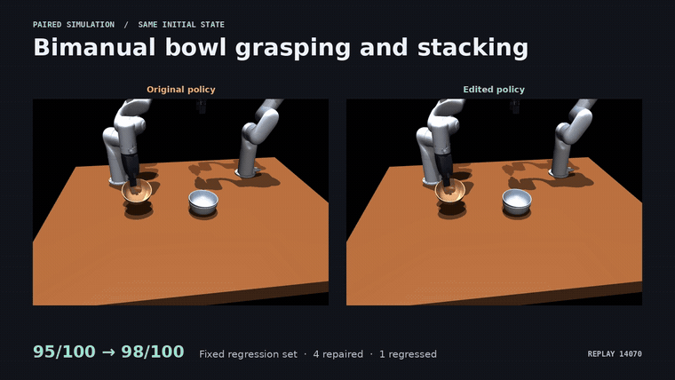
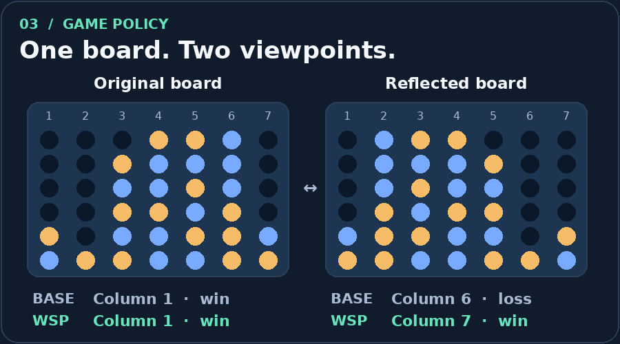
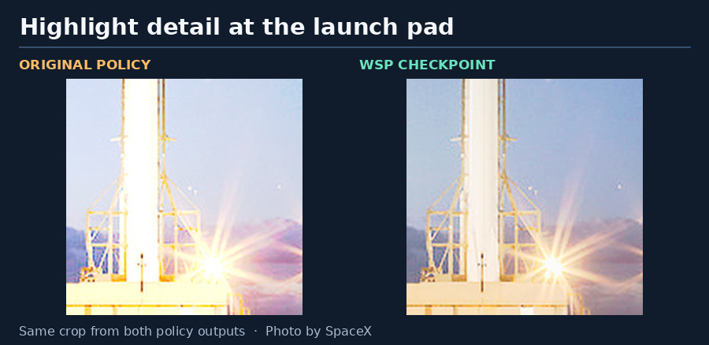

# PolicySculpt

**Direct weight editing for robot policies.**

PolicySculpt brings direct weight editing for embodied control to **Codex and Claude Code**. We used it to improve bimanual bowl stacking and goblet handoff in paired simulation tests with **zero gradient training steps**.

Tsinghua University IEI Lab · [Lab website](https://maureenzou.github.io/lab.html)

[](#codex) [](#claude-code) [](#evaluation-results)

## Robotics Demos

### Bimanual Bowl Grasping and Stacking

Two xArm7 arms pick up bowls and build a three-bowl stack in MuJoCo. In the paired replay below (seed 14067), the original policy leaves the first two bowls tilted and out of alignment. The edited policy keeps those bowls nested and stacks the third. [Watch MP4](assets/showcase/bowl-stacking.mp4)



A CNN locates the bowls at reset. A behavior-cloned MLP uses these locations, live RGB features, and joint feedback to control both arms. We edited one output weight matrix in the MLP's timing branch to adjust when the right gripper opens and how it descends near the stack.

### Bimanual Goblet Handoff

With PolicySculpt, we edited six learned parameters that govern the receiving arm’s approach and phase timing. In the same-start example below, the original policy leaves the goblet tilted **12°**, while the edited policy sets it down upright. [Watch MP4](assets/showcase/goblet-handoff.mp4)


## Beyond Robotics

The same weight-editing workflow also applies to policies evaluated on fixed inputs.

### Connect Four

On the reflected board below, the original policy picked a losing move in column 6. After we edited the action head, the policy picked the winning move in column 7, mirroring column 1 on the original board.



### Photo Retouching

We edited the policy's exposure regressor. In the launch-pad close-up, the edited exposure preserves detail around the base of the rocket. [Full photo comparison](assets/showcase/exposure-rocket.jpg) · [Yosemite Falls example](assets/showcase/exposure-yosemite-falls.jpg)



## Evaluation Results

| Task | Evaluation metric | Original → Edited | Parameters changed |
| --- | --- | ---: | ---: |
| Bimanual bowl grasping and stacking | Three-bowl stacks on the same 100 fixed regression starts | **95/100 → 98/100** | **49,152** of 144,872 in the MLP |
| Bimanual goblet handoff | Successful handoff and stable placement on 28 new starts | **18/28 → 25/28** | **6** of 90,281 |
| Connect Four | Mirror disagreements on 24,000 held-out endgames | **7,928 → 0** | **1,798** of 134,735 |
| Photo retouching | Mean highlight clipping on 65 eligible held-out FiveK photos | **12.90% → 2.50%** | **129** of 6,123,680 |

The bowl-stacking candidate repaired **4 of 5** original failures and retained **94 of 95** original successes. The fixed regression set was used to compare candidates. The full checkpoint has **209,921** learned parameters, including the bowl locator.

## How It Works for Robots

1. Trace a repeatable failure to the computation that drives it.
2. Edit the relevant weights, screen candidates, then save and reload one checkpoint.
3. Run both policies from matched initial states and check task success and retained behaviors.

The policy adapter runs the robot’s existing inference code. The task evaluator resets the environment, runs the robot in closed loop, and scores the outcome. Use PolicySculpt when an existing policy can already perform the task and you can isolate the behavior to improve.

## Quick Start

Start in the project where you want to edit a policy.

### Codex

```bash
git clone https://github.com/Pan-Chera/PolicySculpt.git \
  .agents/skills/robot-weight-programming
```

Invoke `$robot-weight-programming` in Codex.

### Claude Code

```bash
git clone https://github.com/Pan-Chera/PolicySculpt.git .policysculpt
claude --plugin-dir "$PWD/.policysculpt/claude-code"
```

Invoke `/policysculpt:edit` to edit a policy. Use `/policysculpt:embodied` for standalone robot trace analysis or paired simulation. [Claude Code plugin guide](claude-code/README.md)

### Try a Standalone Edit

The [first weight edit](docs/first-edit.md) shows how to edit, save, reload, and evaluate a small policy using the bundled NumPy helper.

### Give the Agent a Task

Provide the checkpoint, native inference command, and an evaluator with representative failures and successes.

```text
Fix this repeatable robot policy failure.
Edit the relevant weights, save and reload a candidate, and compare it
with the original on held-out cases. Check that the original successes still pass.
```

[Skill instructions](SKILL.md) · [Robotics setup](references/robot-workflow.md) · [Policy adapters](references/adapter-and-integrity.md) · [Evaluation and resumption](references/research-efficiency.md)

## Documentation

- [Case evidence and reproducibility](docs/reproducibility.md)
- [Contributing and release checks](CONTRIBUTING.md)
- [Security reporting](SECURITY.md)

## License

PolicySculpt code and documentation are available under the [MIT License](LICENSE). See [third-party notices](THIRD_PARTY_NOTICES.md) for demo photo credits and external assets.

## Authors and Citation

**Guanxing Qu** and **Xueyan Zou**, Tsinghua University IEI Lab. [Citation metadata](CITATION.cff)

The direct weight-editing approach was inspired by Takehi et al. (MIT CSAIL, 2026). [Research article](https://rikiyat.github.io/blog/weight-space-programming/)

```bibtex
@misc{qu2026policysculpt,
  author       = {Qu, Guanxing and Zou, Xueyan},
  title        = {{PolicySculpt (PS): Direct Weight Editing for Trained Policies}},
  year         = {2026},
  howpublished = {GitHub repository},
  url          = {https://github.com/Pan-Chera/PolicySculpt}
}
```

Photo-retouching references and demo credit. [Exposure paper](https://arxiv.org/abs/1709.09602) · [MIT-Adobe FiveK](https://data.csail.mit.edu/graphics/fivek/) · [Falcon 9 photo by SpaceX](https://scikit-image.org/docs/0.25.x/api/skimage.data.html#skimage.data.rocket)
