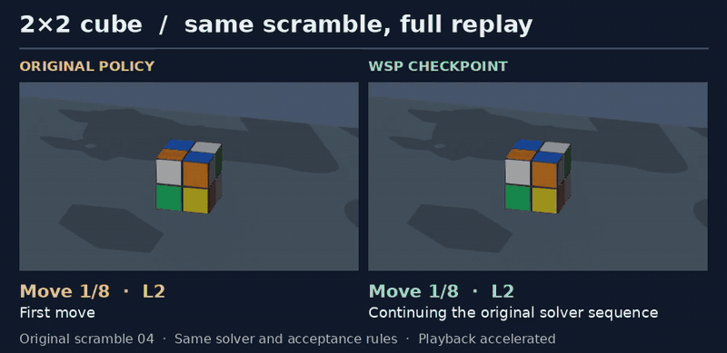
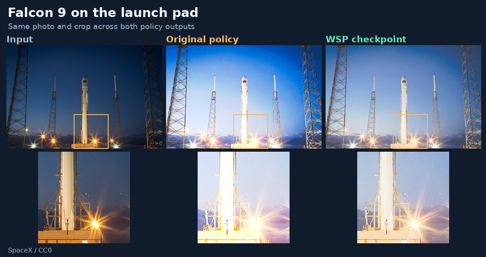
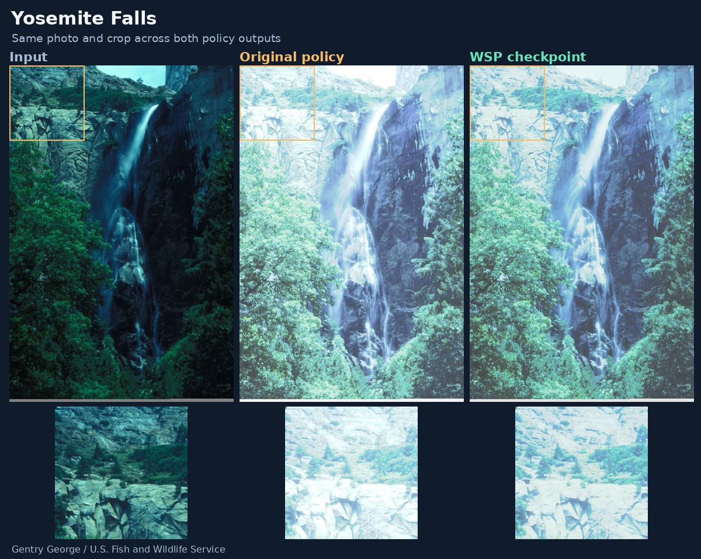

<h1 align="center">Policy Weight-Space Programming</h1>

<p align="center">
  <strong>Gradient-free checkpoint edits for robot control, game decisions, and image retouching.</strong>
</p>

<p align="center">
  <a href="#quick-start">Quick start</a> ·
  <a href="#inside-the-skill">Inside the skill</a> ·
  <a href="#authors">Authors</a> ·
  <a href="#citation">Citation</a>
</p>

<table>
  <tr>
    <td width="50%" align="center">
      <br>
      <strong>Goblet handoff · 18/28 → 25/28</strong><br>
      Complete transfers and stable placements on new paired simulation starts.<br>
      <a href="#goblet-handoff">Case details</a> · <a href="assets/showcase/goblet-handoff.mp4">MP4</a>
    </td>
    <td width="50%" align="center">
      <br>
      <strong>2×2 cube solving · 21/30 → 25/30</strong><br>
      Complete solves on the original paired regression cohort.<br>
      <a href="#bimanual-cube-solving">Case details</a> · <a href="assets/showcase/cube-solve.mp4">MP4</a>
    </td>
  </tr>
  <tr>
    <td width="50%" align="center">
      <br>
      <strong>Connect Four · 7,928 → 0</strong><br>
      Mirror disagreements across 24,000 held-out endgame boards.<br>
      <a href="#connect-four">Case details</a>
    </td>
    <td width="50%" align="center">
      <br>
      <strong>Photo retouching · 12.90% → 2.50%</strong><br>
      Mean recoverable-highlight clipping on 65 eligible held-out photos.<br>
      <a href="#photo-retouching">Case details</a>
    </td>
  </tr>
</table>

## What you can do with it

Policy Weight-Space Programming is a Codex skill for changing a specific behavior in a trained policy and measuring the effect against its original checkpoint.

A robot grazes the wrong layer of a cube. A game policy makes different decisions when the board is mirrored. A retouching policy pushes textured highlights to white. In each case, the skill helps Codex locate the calculation that could explain the behavior and translate a testable hypothesis into an edit to the trained weights.

Start with a checkpoint, its native inference entry point, and examples of the behavior you want to change. Codex traces the path from inputs through the relevant tensors to the action, screens candidate edits, and saves the selected checkpoint. Reloading it through the original inference path tests that the edit survives serialization. Paired evaluation measures the intended improvement and checks behavior you want to preserve.

The four showcase edits used zero gradient-training steps. The same workflow supports static decisions and stateful policies. Each task supplies its own inputs, metrics, and evaluator. Simulation is an optional evaluator for claims about interaction, contact, or task completion.

## The four cases

### Goblet handoff

Two simulated arms pass a goblet in midair and set it down. Six edited scalars shift the receiver’s entry by 1.35 mm and shorten five learned phase durations. Across **28 paired new initial states**, complete handoff and stable placement rose from **18/28 to 25/28**. The confirmation cohort deliberately emphasized the `1→0` direction, where success rose from **14/22 to 21/22**.

The Blender replay uses recorded arm joints and goblet poses from one paired repair. The close-up shows the final placement phase from the same initial state. The original policy fails the release check with the goblet tilted **12.0°**. The edited policy completes stable placement with the goblet upright.

### Bimanual cube solving

One simulated arm holds the cube while the other turns a layer. For bottom quarter-turns, the holding gripper sometimes contacts the rotating layer. The edit shifts its learned trajectory anchors 1.2 mm toward the fixed layer. The solver, acceptance criteria, and other move policies stay fixed.

Full solves rose from **21/30 to 25/30** when replaying the original scrambles, with all 21 original successes preserved. On ten separately frozen new scrambles, the ordinary stratum went from **4/5 to 5/5** and the stratum enriched for a high-risk move sequence went from **0/5 to 5/5**. The Blender clip shows a full replay of original scramble 04. The original policy stops on move two after **20 control ticks** of wrong-layer contact. The edited policy has **zero** wrong-layer contact ticks on that move and completes all eight moves. The final close-up shows both physical cube states.

### Connect Four

A reflected board calls for a correspondingly reflected move. An analytic projection of the final action head makes the two views agree while keeping the trained encoder. The illustrated held-out position shows the original policy selecting a winning move on one board and a losing move on its reflection. The edited head finds the winning mirrored pair.

Across **24,000 held-out endgame boards**, mirror disagreements fell from **7,928 to zero** and exact-solver optimal actions rose from **84.99% to 85.73%** across both orientations. On the boards where the original policy disagreed with its reflection, optimality rose from **79.03% to 81.29%**, compared with **79.75%** for a tuned action-bias control.

### Photo retouching

The Exposure policy selects a sequence of photographic edits. The WSP candidate changes **128 weights and one bias** in the learned exposure-strength regressor to reduce clipping of initially textured highlights. Mean any-channel clipping fell from **12.90% to 2.50%** across **65 eligible photos** from 72 held-out full-frame images. The paired photo bootstrap interval for the change was **−13.40 to −7.65 percentage points**.

The aggregate chart reports measured clipping on the held-out FiveK photos. Shadow rendering can also change when the policy selects a different exposure strength. [Exposure paper](https://arxiv.org/abs/1709.09602) · [MIT-Adobe FiveK dataset](https://data.csail.mit.edu/graphics/fivek/)

The selected photos below show the input and both policy outputs with a matched crop. The rocket comparison shows detail around the illuminated structure at the foot of the rocket. The waterfall comparison shows texture in the bright rock face.



Photo by SpaceX, released into the public domain. [Photo source](https://scikit-image.org/docs/0.25.x/api/skimage.data.html#skimage.data.rocket)



Photo by Gentry George, U.S. Fish and Wildlife Service, released into the public domain. [Photo source](https://commons.wikimedia.org/wiki/File:Yosemite_falls.jpg)

[View the aggregate clipping chart](assets/showcase/exposure.png)

## Quick start

From the workspace where you want to use the English skill, clone the repository into the project’s Codex skills directory. Repository access is required.

```bash
git clone https://github.com/Pan-Chera/robot-weight-programming.git \
  .agents/skills/robot-weight-programming
```

Open that workspace in Codex and invoke `$robot-weight-programming`. Point it to the model and inference command, identify a failure and something the policy should keep doing well, and set a screening budget. [Codex skill setup](https://developers.openai.com/codex/skills)

```text
Use $robot-weight-programming on this frozen checkpoint.
The native inference command and labeled examples are in this workspace.
Improve the target behavior described in the examples while preserving the
original successes. Diagnose the relevant computation, screen direct weight
edits on the development cases, then freeze one candidate and compare it
with the original checkpoint on the reserved cases.
```

For an **offline policy**, representative inputs and a task metric are enough to begin. If the claim concerns **closed-loop behavior**, also provide the existing evaluator, initial states or reset procedure, and acceptance criteria. The model runtime belongs to the task adapter, so the skill can work with native checkpoints and different evaluators.

A completed run can produce an edited checkpoint, a parameter diff, and a paired report with the baseline identity, metrics, and behavior retained. Long evaluations can resume by sample after checking that the models, sample inputs, and evaluation setup match the saved results.

## Inside the skill

| Entry | What it covers |
| --- | --- |
| [Skill entry point](SKILL.md) | Baseline reproduction, mechanism diagnosis, candidate screening, and confirmation |
| [Policy adapters](references/adapter-and-integrity.md) | Native loading, state and randomness, save/reload checks, and parameter integrity |
| [Interventions](references/intervention-workflow.md) | Choosing a weight edit and testing capability retention |
| [Evaluation and resumption](references/research-efficiency.md) | Budget, screening and stopping rules, held-out confirmation, and sample-level continuation |
| [Robotics workflow](references/robot-workflow.md) | Optional guidance for simulation and physical robot tasks |
| [Helpers](scripts/) | Affine edits, portable checkpoint patches, and evidence checks |

## Authors

**Guanxing Qu** and **Xueyan Zou**  
Interactive Embodied Intelligence Lab (IEI Lab), College AI, Tsinghua University. [IEI Lab](https://maureenzou.github.io/lab.html) · [Multi-Agent CAD](https://github.com/Pan-Chera/Multi-Agent-CAD)

## Citation

If you use this skill, cite the software repository.

```bibtex
@misc{qu2026policywsp,
  author       = {Qu, Guanxing and Zou, Xueyan},
  title        = {{Policy Weight-Space Programming}},
  year         = {2026},
  howpublished = {GitHub repository},
  url          = {https://github.com/Pan-Chera/robot-weight-programming}
}
```

The skill is inspired by Rikiya Takehi, Jayden Teoh, Alex Zhang, and Omar Khattab’s *Sparks of Weight-Space Programming* (2026). [Original article](https://rikiyat.github.io/blog/weight-space-programming/)
