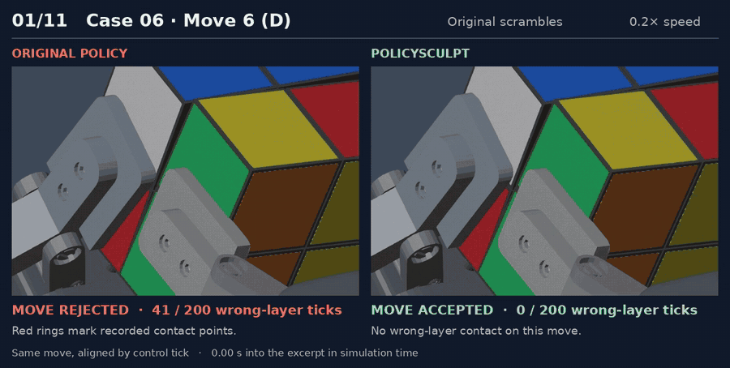

# PolicySculpt

**Direct weight editing for robot policies.**

PolicySculpt brings direct weight editing for embodied control to **Codex and Claude Code**. We used it to improve bimanual goblet handoff and 2×2 cube solving in paired simulation tests with **zero gradient training steps**.

Tsinghua University IEI Lab · [Lab website](https://maureenzou.github.io/lab.html)

[](#codex) [](#claude-code) [](#robotics-results)

## Robotics Results

| Simulated task | Paired test | Original → Edited | Parameters changed |
| --- | --- | ---: | ---: |
| Bimanual goblet handoff | Successful handoff and stable placement on 28 new starts | **18/28 → 25/28** | **6** of 90,281 |
| Bimanual 2×2 cube solving | Full solves on the same 30 scrambles | **21/30 → 25/30** | **5,474** of 2,084,480 |

### Bimanual Goblet Handoff

With PolicySculpt, we edited six learned parameters that govern the receiving arm’s approach and phase timing. In the same-start example below, the original policy leaves the goblet tilted **12°**, while the edited policy sets it down upright. [Watch MP4](assets/showcase/goblet-handoff.mp4)


### Bimanual 2×2 Cube Solving

We shifted learned trajectory anchors for the holding gripper away from the rotating layer. In this close-up, cross-layer contact fell from **41/200 to 0/200 control steps**. Red marks contact, and green marks clearance. [Second close-up](assets/showcase/cube-case-28.gif)



The replay kept all **21** original solves. On a separate set of 10 new scrambles, split evenly between ordinary and high-risk move sequences, full solves rose from **4/10 to 10/10**.

## Beyond Robotics

The same weight-editing workflow also applies to policies evaluated on fixed inputs.

### Connect Four

On the reflected board below, the original policy picked a losing move in column 6. The edited policy picked the winning move in column 7, mirroring column 1 on the original board. We edited **1,798 parameters** in the action head of a **134,735-parameter** policy and reduced mirror disagreements from **7,928 to 0** across **24,000 held-out endgames**.


### Photo Retouching

We edited **129 parameters** in the exposure regressor of a **6,123,680-parameter** policy and reduced mean highlight clipping from **12.90% to 2.50%** across **65 eligible held-out FiveK photos**. In the launch-pad close-up, the edited exposure preserves detail around the base of the rocket. [Full photo comparison](assets/showcase/exposure-rocket.jpg) · [Yosemite Falls example](assets/showcase/exposure-yosemite-falls.jpg)


## How It Works for Robots

1. Trace a repeatable failure to the computation that drives it.
2. Edit the relevant weights, screen candidates, then save and reload one checkpoint.
3. Run both policies from matched initial states and check task success and retained behaviors.

The policy adapter runs the robot’s existing inference code. The task evaluator resets the environment, runs the robot in closed loop, and scores the outcome. Use PolicySculpt when an existing policy can already perform the task and you can isolate the behavior to improve.

## Quick Start

Start in the project where you want to edit a policy. Access to the private repository is required.

### Codex

```bash
git clone https://github.com/Pan-Chera/PolicySculpt.git \
  .agents/skills/robot-weight-programming
```

Invoke `$robot-weight-programming` in Codex.

### Claude Code

```bash
git clone https://github.com/Pan-Chera/PolicySculpt.git .policysculpt
claude --plugin-dir "$PWD/.policysculpt/claude-code"
```

Invoke `/policysculpt:edit` to edit a policy. Use `/policysculpt:embodied` for standalone robot trace analysis or paired simulation. [Claude Code plugin guide](claude-code/README.md)

### Give the Agent a Task

Provide the checkpoint, native inference command, and an evaluator with representative failures and successes.

```text
Fix this repeatable robot policy failure.
Edit the relevant weights, save and reload a candidate, and compare it
with the original on held-out cases. Check that the original successes still pass.
```

[Skill instructions](SKILL.md) · [Robotics setup](references/robot-workflow.md) · [Policy adapters](references/adapter-and-integrity.md) · [Evaluation and resumption](references/research-efficiency.md)

## Authors and Citation

**Guanxing Qu** and **Xueyan Zou**, Tsinghua University IEI Lab. [Citation metadata](CITATION.cff)

The direct weight-editing approach was inspired by Takehi et al. (MIT CSAIL, 2026). [Research article](https://rikiyat.github.io/blog/weight-space-programming/)

```bibtex
@misc{qu2026policysculpt,
  author       = {Qu, Guanxing and Zou, Xueyan},
  title        = {{PolicySculpt (PS): Direct Weight Editing for Trained Policies}},
  year         = {2026},
  howpublished = {GitHub repository},
  url          = {https://github.com/Pan-Chera/PolicySculpt}
}
```

Photo-retouching references and demo credit. [Exposure paper](https://arxiv.org/abs/1709.09602) · [MIT-Adobe FiveK](https://data.csail.mit.edu/graphics/fivek/) · [Falcon 9 photo by SpaceX](https://scikit-image.org/docs/0.25.x/api/skimage.data.html#skimage.data.rocket)
